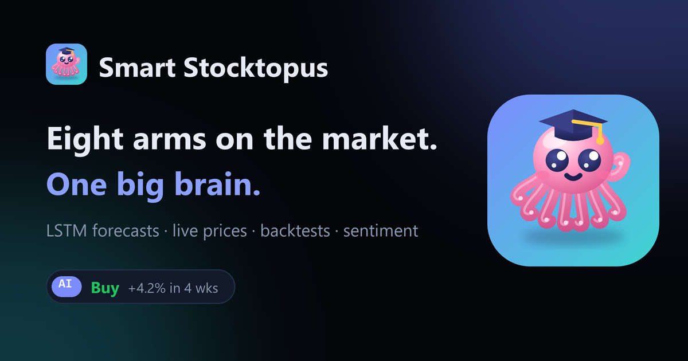

# Smart Stocktopus 🐙

*Eight arms on the market. One big brain.*

**Live app: [smart-stocktopus.vercel.app](https://smart-stocktopus.vercel.app/)**

[](https://smart-stocktopus.vercel.app/)

Smart Stocktopus is a stock research web app. It combines live market data
with an LSTM price forecast, Monte Carlo confidence ranges, strategy
backtests, a technical scorecard and news sentiment, for any stock, ETF,
index or crypto that Yahoo Finance lists. It is upfront about what the AI can
and can't do, and shows the model's real accuracy next to every forecast.

> For educational use only. Market data is delayed and provided as-is. This is not financial advice.

## Why an octopus?

Octopuses are some of the smartest animals in the sea. They solve puzzles,
open jars and use tools, and about two-thirds of their neurons sit in their
arms, so each arm can explore on its own while one brain ties it all together.

Smart Stocktopus works the same way: eight arms reaching into the market,
one brain making sense of it all.

| | Arm | Where |
| --- | --- | --- |
| 1 | Live prices: ticker tape, market overview, sector heatmap, top movers | [Markets](https://smart-stocktopus.vercel.app/) |
| 2 | AI forecasts: 1–12 week LSTM path with a Buy/Hold/Sell signal | [Stock page](https://smart-stocktopus.vercel.app/stock/NVDA) |
| 3 | Monte Carlo ranges: 50% and 90% bands around the forecast | Stock page |
| 4 | Technical scorecard: seven signals in one −100…+100 gauge | Stock page |
| 5 | Strategy backtests: four strategies vs buy & hold, with costs and no look-ahead | Stock page |
| 6 | News sentiment: headlines scored with VADER plus finance terms | Stock page |
| 7 | Compare: rebased performance, risk table and correlations | [Compare](https://smart-stocktopus.vercel.app/compare) |
| 8 | Your portfolio: value, gains, allocation and risk vs the S&P 500 | [Portfolio](https://smart-stocktopus.vercel.app/portfolio) |

## Pages

- **Markets** (`/`): ticker tape, market tiles with sparklines (indices, crypto, gold, oil, yields, FX), sector heatmap, top gainers and losers among 40 mega-caps, your watchlist, and the tickers most forecast on the site.
- **Stock** (`/stock/<symbol>`): AI verdict badge, key stats and trailing returns, a candlestick or line chart with MA50/MA200, volume and RSI or MACD, the AI forecast with its live track record, the technical scorecard, news sentiment and the strategy backtest.
- **Compare** (`/compare`): up to six tickers, with presets such as Big tech or Crypto vs S&P.
- **Portfolio** (`/portfolio`): holdings with optional average cost. Holdings and the watchlist are saved in your browser; there are no accounts.
- **About** (`/about`): how the project and the model work.

Also: dark and light themes, a phone layout with a bottom tab bar, ticker search with autocomplete (press `/`), plain-English tooltips on finance terms, and link previews when the site is shared.

## How it works

| Piece | File |
| --- | --- |
| Market data: Yahoo Finance JSON endpoints via `requests`, cached in-process; optional Twelve Data fallback | `src/market_data.py` |
| Indicators (MA50/200, MACD, RSI) | `src/feature_engineering.py` |
| Training data: 60-day windows normalised to the last close, next-day log return as the target | `src/preprocessing.py` |
| Model training (TensorFlow, offline) | `src/train.py` |
| Keras → NumPy export, scored on the held-out test split | `scripts/export_models.py` |
| LSTM forward pass in pure NumPy, used at runtime | `src/nn.py` |
| Recursive multi-day forecast | `src/inference.py` |
| Monte Carlo, backtests, risk stats, scorecard, compare, portfolio | `src/analytics.py` |
| Signal and explanation, headline sentiment | `src/advisor.py` |
| Flask pages and JSON API | `src/webapp/` |
| Vercel entry point | `api/index.py`, `vercel.json` |

**Why NumPy at runtime?** TensorFlow is over 1 GB installed, far above
Vercel's 250 MB function limit. The trained weights are exported to
`models/universal.npz` (120 KB), and `src/nn.py` replays the LSTM in NumPy.
It matches Keras to within 1e-7, and the deployed dependencies come to about 125 MB.

**The model.** One "universal" LSTM (64 → 32 units) trained on ten years of
20 large caps and ETFs. Its inputs don't depend on the price level, so it can
be applied to any ticker. On its held-out test set it gets next-day direction
right about 52% of the time and matches the naive "tomorrow equals today"
price error. That's realistic for daily stock prediction, and the app says
so rather than hiding it.

### API

All endpoints return JSON and send `Cache-Control: s-maxage` headers, so
Vercel's CDN absorbs repeat traffic.

| Endpoint | Returns |
| --- | --- |
| `GET /api/market` | Overview, sectors, movers, model stats, trending |
| `GET /api/quotes?symbols=AAPL,MSFT` | Quotes with intraday sparklines |
| `GET /api/search?q=nvidia` | Ticker search |
| `GET /api/analysis/<sym>` | History and indicators, stats, returns, scorecard |
| `GET /api/forecast/<sym>?weeks=4` | LSTM and Monte Carlo forecast, signal, explanation |
| `GET /api/backtest/<sym>?years=3` | Strategy equity curves and stats |
| `GET /api/news/<sym>` | Headlines with sentiment |
| `GET /api/compare?symbols=A,B&range=1y` | Rebased series, stats, correlations |
| `GET /api/portfolio?holdings=AAPL:10,MSFT:5&range=1y` | Portfolio value history, risk, weights |
| `GET /health` | Health check |

## Run locally

```bash
python -m venv .venv
.venv\Scripts\activate        # Windows; use `source .venv/bin/activate` elsewhere
pip install -r requirements.txt
flask --app src.webapp.app run
```

Then open http://127.0.0.1:5000.

## Tests

```bash
pip install pytest
pytest
```

The tests mock all market data, so they run offline. GitHub Actions also runs
a secrets scan, bandit, a dependency audit and a Docker image scan on every push.

## Deploy

The live app runs on **Vercel**. To deploy your own copy, import the repo at
[vercel.com/new](https://vercel.com/new) and keep the defaults: `vercel.json`
sends every request to the Flask app in `api/index.py`, and Vercel installs
`requirements.txt`.

Optional environment variables:

| Variable | Purpose |
| --- | --- |
| `DATABASE_URL` | Keep the "trending" forecast log between restarts (e.g. a Neon or Supabase Postgres URL; add `psycopg[binary]` to `requirements.txt`). Without it, SQLite in `/tmp` is used and resets on cold starts. |
| `TWELVEDATA_API_KEY` | Fallback price history if Yahoo is unreachable. |
| `NEWSAPI_KEY` | Extra news source for sentiment when Yahoo has no headlines. |
| `SECRET_KEY` | Flask session key (required when `FLASK_ENV=production`). |

Other hosts:

- **Docker**: `SECRET_KEY=change-me docker compose up --build`
- **Render**: `render.yaml` describes the service. Choose **New → Blueprint** and pick this repo.
- **Hugging Face Spaces**: the front matter at the top of this file configures a Docker Space.

## Retrain the model

Training needs TensorFlow, so it uses a separate requirements file:

```bash
pip install -r requirements-train.txt
python -m src.preprocessing           # 10 years of the 20-ticker universe
python -m src.train                   # writes models/lstm_universal.h5
python scripts/export_models.py       # writes models/universal.npz (what the app loads)
```

To give one ticker its own model, pass `--ticker NVDA` to the first two
commands and then run `python scripts/export_models.py NVDA`. The app prefers
a ticker's own model over the universal one.

## Built by

**Agnes Hephzibah Roche** ([GitHub](https://github.com/agneshephzibahroche)): data pipeline, model training,
analytics and the web app. The [About page](https://smart-stocktopus.vercel.app/about) covers how it was built.
